# Mosaic Android

An Android app built with Flutter that creates video contact sheets, screenshots, animated previews, and animated contact sheets directly on your phone. Videos are processed locally with bundled FFmpeg and FFprobe libraries; no server, account, or separate command-line tool installation is required. The interface supports Korean, English and Japanese.

**[Published releases](https://github.com/idlepoe/mosaic/releases)** · Current version: **1.4.1+10**

## Download on your phone

[**Download the Android ARM64 APK (v1.4.1)**](https://github.com/idlepoe/mosaic/releases/download/v1.4.1/Mosaic-Android-v1.4.1-arm64.apk)

Scan this QR code with your phone camera to open the APK download link.
Open the downloaded APK and follow Android's installation prompts.

<a href="https://github.com/idlepoe/mosaic/releases/download/v1.4.1/Mosaic-Android-v1.4.1-arm64.apk"></a>

## Version 1.4.1 updates

App info now includes **Check for updates**. Release builds also check once per day
at startup. A new-version dialog shows release notes and downloads the matching APK
with progress, cancellation, SHA-256 verification and an Android installation button.
See [update behavior and release metadata](docs/UPDATES.md).

This release also includes multiple-result deletion, 30 FPS / 10-second animation
settings, and the settings clipping fixes.

## Version 1.4 mascot screens and motion

The six-pose rough cartoon octopus now appears in native/initial-loading splash,
empty video and results states, the settings header, generation progress, and
completion/error feedback. A separate tile moves into the loading mascot's empty
mosaic slot on a 2.4-second loop. The real progress bar and cancellation stay
independent of the decoration. Reduced motion uses a still frame, and hidden or
inactive loaders stop their animation.

Artwork is bundled locally with no text baked into the images. Feedback remains
localized in Korean, English, and Japanese. See [mascot implementation and
validation](docs/MASCOT_IMPLEMENTATION.md).

| Video selection | Settings | Empty results |
|---|---|---|
| 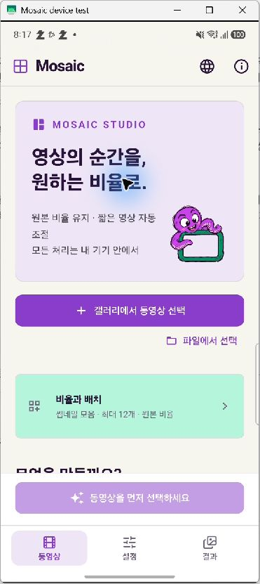 | 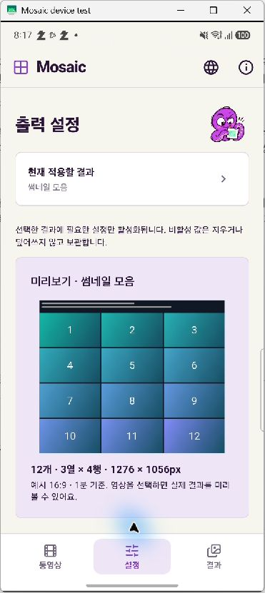 | 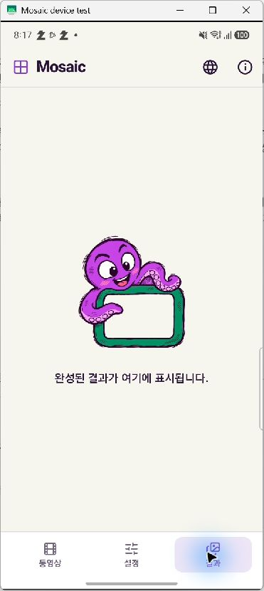 |

## Version 1.3 design refresh

The app uses the Flutter `shadcn_ui` component library with a custom octopus-inspired
palette: purple primary actions, green gallery saves, mint accents, a cream light
background, and a matching dark theme. Buttons, choices, switches, sliders, inputs,
format selectors, cards, settings accordions, dialogs, progress, and bottom
navigation follow the same visual system. Existing generation settings and all
three languages remain available. This stage does not add in-screen mascot art
or loading animations.

See [design implementation and validation](docs/DESIGN_SYSTEM.md).

## Version 1.2 localization

Korean, English, and Japanese are available through the app bar language button.
The default follows the device language, with English fallback. See [localization](docs/LOCALIZATION.md) for behavior, maintenance, and verification.

## Version 1.1 improvements

- **Independent aspect ratios:** keep the source ratio for each thumbnail, or choose 16:9, 9:16, 4:3, 3:4, or 1:1. The overall sheet also offers an optional fixed canvas ratio.
- **No outer black gutters by default:** content-fit mode uses the full output width and calculates height from the thumbnail aspect and row count. It retains gaps between cells but removes the unused outer canvas. Existing settings migrate to this default. Fixed-ratio canvas mode remains optional and can introduce padding.
- **Gallery workflow:** the primary picker opens the Android photo/video picker, the queue shows extracted scene thumbnails, and Save writes results into the gallery's **Mosaic** album. A file picker and document export remain available as fallbacks.
- **No stretching:** fit the complete frame with padding, or explicitly choose center cropping. Rotation and sample aspect ratio are normalized before calculating dimensions.
- **Mobile rotation workaround:** when FFprobeKit omits stream rotation side data, Android's MediaMetadataRetriever supplies it. Unsupported native containers fall back to measuring one autorotated FFmpeg frame.
- **Adaptive sample counts:** the selected count is an upper bound by default. With the default two-second spacing, a two-second source produces one sample instead of nine repeated copies. A full-length short animation is sampled once even with automatic adjustment disabled.
- **More cells:** static and animated grids both support up to 10 × 10 (100 cells). Animated grids are merged row by row rather than opening 100 decoding streams simultaneously.
- **Live layout preview:** see the actual sample count, layout, output dimensions, padding, and aspect ratio using the selected video's metadata.
- **Explicit layout modes:** automatic arrangement uses its own maximum count; manual arrangement uses stored rows and columns. Changing a ratio no longer overwrites manual layout values.
- **Simpler workflow:** output cards, sample-count presets, row/column steppers, compact advanced options, readable progress, and larger proportion-preserving previews.

### How short videos are sampled

The original Rust implementation samples still frames at `duration / (count + 1)` intervals, regardless of source length. For animations, it restricts start times to `duration - clip_length` and rejects sources no longer than the requested clip. The initial mobile port allowed shorter clips but could produce repeated zero-second starts; this version fixes that behavior.

With automatic adjustment enabled, the count is limited by `floor(duration / max(sample_interval, clip_length))` for animations, or `floor(duration / sample_interval)` for still images, with a minimum of one. Animation samples do not overlap in this mode. Static timestamps are also bounded by the last expected frame so a single-frame source does not seek past its only image. Reduced grids compact to the actual count rather than retaining empty rows.

| Source duration | Maximum selected | Default two-second spacing |
|---|---|---|
| 0.25–3 seconds | 16 | 1 sample |
| 10 seconds | 16 | 5 samples |
| 32 seconds | 16 | 16 samples |

This is time-based sampling, not scene-change or visual-duplicate detection. An unchanging source can still contain visually identical frames. Disable automatic adjustment to request a denser manual grid, subject to available frames and valid clip starts.

See [version 1.1 validation](docs/V1_1_TESTING.md) for the original-logic comparison and real-device tests, including a 100-cell animated output and a single-frame source.

### Settings groups and applicability

Settings are divided into eight numbered groups. Inactive groups remain identifiable and explain why their controls cannot be used. Values are retained when an option is disabled.

| Group | Applies to / mode rules |
|---|---|
| 1. Individual scene aspect | All selected outputs. Crop controls are disabled for source aspect; the stored crop choice is retained. |
| 2. Sheet canvas | Static and animated sheets only. Content-fit and fixed canvas are exclusive; fixed-ratio controls are disabled during content-fit. |
| 3. Sheet arrangement | Sheets only. Automatic maximum count and direct row/column controls are exclusive and preserve each other's values. |
| 4. Sampling and resolution | Shared by selected outputs. Temporal spacing is disabled when adaptive counts are off. |
| 5. Static images | Static sheet/screenshots only. JPEG quality is disabled for lossless PNG. Screenshot count is independent of reel count. |
| 6. Animation | Animated outputs only. Reel format/count are inactive when only animated sheets are selected. WebP quality does not apply to GIF/WebM. Clip duration (0.5–10 seconds in 0.5-second steps) and FPS (4–30 in 1 FPS steps) are explicitly shared by animated outputs. |
| 7. Labels and spacing | Timestamps, headers, gaps, and background are individually enabled only for outputs that use them. |
| 8. Filenames | Shared output suffix. Existing result files are never overwritten. |

JPEG and WebP quality are independent saved values. Screenshot and reel sample counts are also independent. Older single quality/count preferences are migrated into both new fields without losing their values.

## Original project

This project is a mobile port based on **[Mosaic by mosaicvideo](https://github.com/mosaicvideo/mosaic)**, an open-source desktop application for Windows, macOS, and Linux.

- Original repository: [mosaicvideo/mosaic](https://github.com/mosaicvideo/mosaic)
- Original website: [mosaicvideo.github.io](https://mosaicvideo.github.io/)
- Reference version: **v0.1.10**, commit [`ffed6a225267c063034b3e31eccfbadd70a21846`](https://github.com/mosaicvideo/mosaic/tree/ffed6a225267c063034b3e31eccfbadd70a21846)
- Local reference checkout used for this port: `C:\Workspace\mosaic_sample`
- Original license: **MIT**, copyright 2026 Mosaic contributors. See [LICENSE](LICENSE).

This Flutter implementation is an Android adaptation of the original project. It does not imply endorsement by the original maintainers.

## Features

| Output | Formats | Description |
|---|---|---|
| Contact sheet | JPEG, PNG | A grid of evenly sampled frames with optional timestamps and a filename/metadata header |
| Screenshots | JPEG, PNG | Individual frames sampled throughout a video, with optional timestamps |
| Animated preview | WebP, GIF, WebM | Short segments sampled throughout a video and joined into a silent preview |
| Animated contact sheet | WebP | Multiple short video segments playing together in a grid, with optional start-time labels and header |

Additional features include multiple-file selection, a sequential processing queue, per-file status, step progress, cancellation, saved settings, metadata inspection, image zoom, animation preview, Android document export, sharing, and collision-safe output filenames.

## Screenshots

The current **1.4.1+10** settings separate conflicting modes and disable inapplicable controls:

| Grouped settings | Automatic / manual modes | Output-specific controls |
|:---:|:---:|:---:|
| 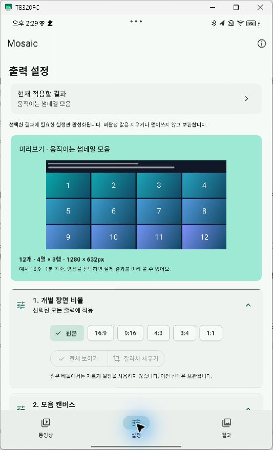 | 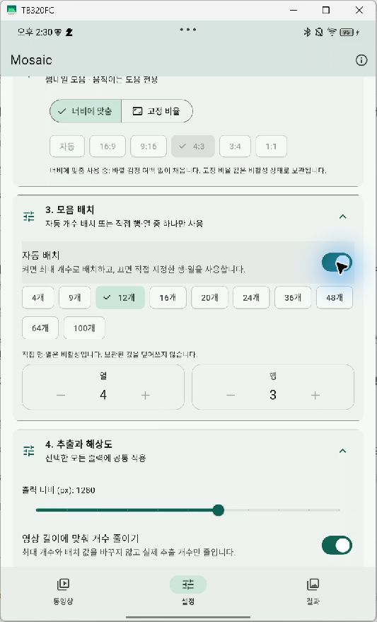 | 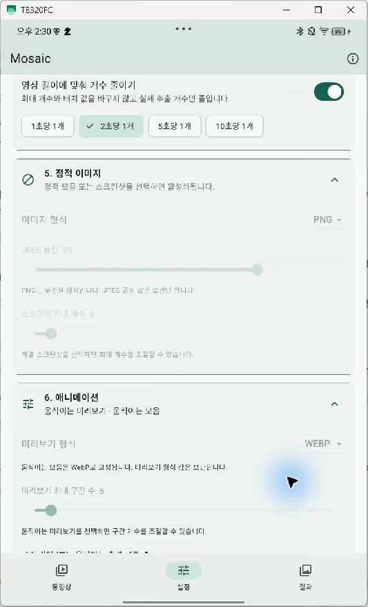 |

The [version 1.1 screenshot index](docs/screenshots/v1.1/README.md) distinguishes final settings captures from intermediate design captures. Real personal video frames are not included.

The gallery below records **v1.0.0**. These are actual screenshots of the physical **SM-S931N** device mirrored through **scrcpy**, captured during testing on **November 6, 2026**. The color-bar video is a test fixture from the original repository.

| Video queue | Output settings | Output selection |
|:---:|:---:|:---:|
| 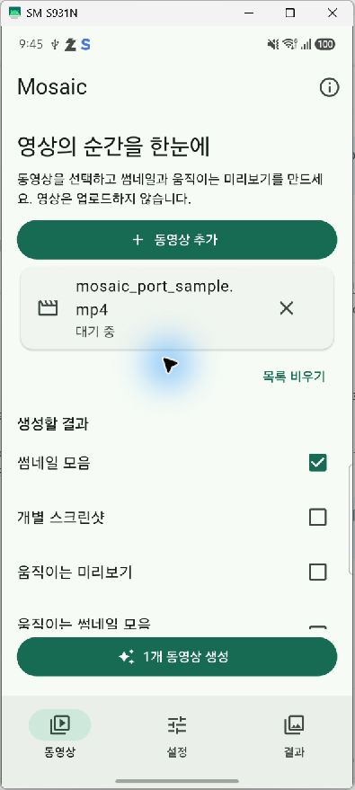 | 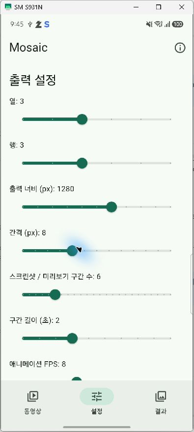 | 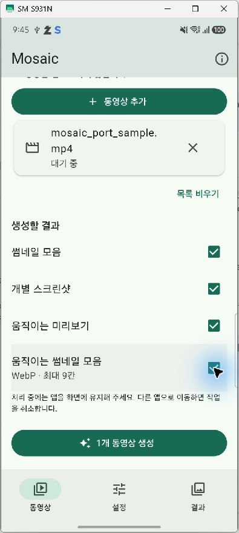 |

| Processing | Animated results | Static contact sheet |
|:---:|:---:|:---:|
| 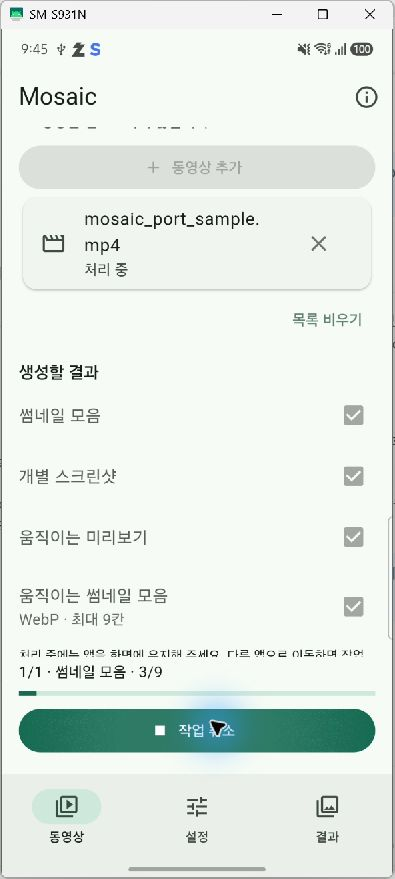 | 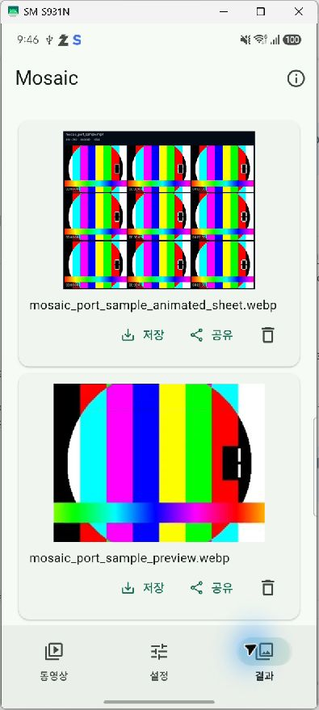 | 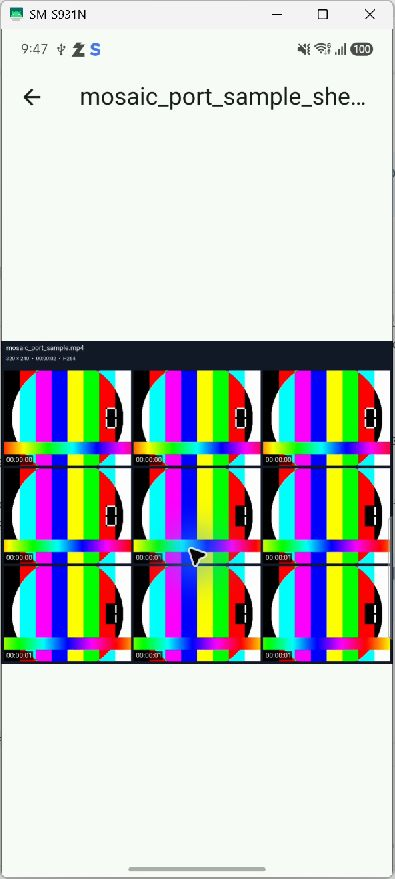 |

See the [complete screenshot index](docs/screenshots/README.md) for all 12 captures and the [physical-device test report](docs/TESTING.md) for the test steps and results.

## What was ported

The original application uses a **Tauri 2 frontend and Rust backend**, which launch desktop `ffmpeg`, `ffprobe`, and `mediainfo` processes. This port implements the UI in **Flutter/Dart** and calls **FFmpegKit full** through its Flutter plugin. The desktop executables and Tauri shell are not included in the Android app.

The Dart processing implementation follows the original application's four-output workflow, evenly spaced frame sampling, bounded clip-start sampling, aspect-ratio handling, grid composition, configurable suffixes, filename collision handling, and completion/cancellation model. Rust source is used as a reference rather than linked as an unchanged library.

| Original behavior | Android implementation |
|---|---|
| Desktop HTML/CSS/JavaScript interface | Korean Material 3 UI with Videos, Settings, and Results navigation |
| External FFmpeg and FFprobe processes | Bundled native libraries called through `ffmpeg_kit_flutter_new_full` |
| Frame sampling and pipeline orchestration | Dart implementation; sampled clips do not extend beyond the source duration |
| Static headers and timestamps | Flutter Canvas rendering, including phone font support |
| File and folder input | Gallery/photo-picker video selection, with a file-picker fallback |
| Desktop output directory | App-private results plus MediaStore gallery saving and optional document export |
| Reveal in Explorer/Finder | In-app preview, document export, and the Android share sheet |
| MediaInfo enrichment and report | FFprobe JSON metadata viewer; commercial codec-name enrichment is not reproduced |
| Parallel desktop work | Sequential processing to reduce memory pressure and heat |
| Output naming | Default or custom suffixes, with `(1)`, `(2)`, etc. added to avoid overwriting results |

### Mobile limits and excluded features

- **Static and animated grids:** up to 10 × 10 cells (100). Screenshots and preview reels support up to 100 samples/segments. Automatic adjustment can produce fewer samples for short sources.
- Output width is limited to **1920 px**. Large combinations are scaled down proportionally to stay within the image-area budget (16 megapixels for static output, 8 for animated grids) and an 8192-pixel height. Unreadably small cell combinations are rejected with an explanation.
- Fonts use mobile defaults instead of exposing every desktop typography option. Rendered results are not pixel-identical to the desktop version.
- Preview reels are silent and do not include metadata headers or timestamp overlays. Animated contact-sheet labels show each segment's start time, not a continuously updating clock.
- **HDR10/HLG:** SDR tone mapping is used only when the bundled engine exposes the required `zscale` filter. Otherwise the app reports an unsupported operation.
- **Dolby Vision:** excluded until accurate mobile color conversion is validated; affected input is rejected with an explanation.
- Desktop CLI commands, recursive folder scanning, desktop drag-and-drop, package-manager installation, and the desktop self-updater are excluded.
- Long-running background processing is not implemented. The app keeps the display awake while generating; moving it to the background cancels the active batch. Interrupted work must be started again.
- Codec and container support depends on the bundled FFmpeg build. This port does not promise support for every possible input file.

## Using the app

1. Open **Videos** (`동영상`) and tap **Select from gallery** (`갤러리에서 동영상 선택`). Select one or more videos. Use **Select from files** (`파일에서 선택`) for inputs not indexed by the gallery.
2. The queue shows a small scene thumbnail, filename, displayed dimensions, duration, and status. Select the output types. Tap a queue item to inspect its metadata.
3. Open **Settings** (`설정`) to adjust grid size, width, spacing, sample count, segment duration, FPS, quality, timestamps, header, background, formats, and filename suffix.
4. Tap **Generate**. Keep the app visible until processing finishes. Use **Cancel** to stop the batch.
5. Open **Results** (`결과`) to preview the files. Tap an image to enlarge it; animated images play in the preview.
6. Tap **Save to gallery** (`갤러리 저장`) to create a copy in the **Mosaic** album. Images and animations are stored under `Pictures/Mosaic`; WebM video previews use `Movies/Mosaic`. The folder icon opens the optional document export dialog, and **Share** (`공유`) opens the share sheet.

7. To remove several app results, tap **Select files** (`파일 선택`) on **Results**, check the files, then tap **Delete selected** (`선택 삭제`). **Select all** / **Clear selection** toggles the whole list. Long-pressing an image also enters selection mode. Confirm the file count before deletion. Original videos and copies already saved to the gallery or another folder are kept. Failed deletions remain selected for retry; individual delete buttons are still available outside selection mode.

See the [bulk deletion verification report](docs/RESULTS_DELETION_QA.md) for physical-device screenshots and test coverage.

Android 13+ uses the system Photo Picker. Earlier Android versions use the available gallery picker; if none is available, the system document picker is used. Android 10+ gallery saving uses scoped MediaStore without broad storage permission. Android 7–9 requests storage permission when saving. Gallery apps vary in animated WebP, GIF, and WebM playback support; the original output can always be exported as a file.

### Storage and privacy

Videos are not uploaded. Input files may be copied into the system picker's app cache, so the device needs sufficient free space. Completed outputs are stored in the app's private documents directory and rediscovered after restarting the app. Export important results before uninstalling: uninstalling removes app-private files.

Gallery-selected videos are streamed into app-private cache for FFmpeg processing. Queue preview images are small cached JPEGs; preview failure does not prevent generation. Removing a queue item clears only its app-owned import/preview cache, never the original gallery video. Copies saved to the public Mosaic album survive app uninstallation.

Each pipeline writes to a temporary working directory. Completed files are moved into the results directory only after successful generation. Cancellation or failure cleans up that job's temporary files while retaining already completed outputs. The input queue itself is not restored after restarting the app.

## Build and run

Requirements: Flutter 3.41 / Dart 3.11 or later, Android SDK, and a compatible Java toolchain. The Android build targets **API 24+ (Android 7.0+)**. The project compiles Java/Kotlin sources for Java 17.

```sh
flutter pub get
flutter devices
flutter run -d <physical-device-id>
```

Build a debug APK:

```sh
flutter build apk --debug
```

Build an ARM64 release-mode APK:

```sh
flutter build apk --release --target-platform android-arm64 --split-per-abi
```

Output: `build/app/outputs/flutter-apk/app-arm64-v8a-release.apk` (approximately 61.2 MB for the tested build).

Release builds require an untracked `android/key.properties` containing `storeFile`, `storePassword`, `keyAlias`, and `keyPassword`. `storeFile` may point to a keystore outside this repository. The build fails if release signing is missing; it never falls back to debug signing. Both signing properties and keystore files are excluded from Git. Never commit signing credentials or attach them to a release.

The current build is version **1.4.1+10** and uses the local release key configured using the same approach as the `gps_gallery` project. The earlier physical-device tests below used build **1.0.0+1** with development signing. Android cannot install the release-signed APK over that development-signed installation; use a fresh installation or a device already using the same release key. Preserve any needed app-private results before removing an older installation. Debug builds use a separate `.dev` application ID.

## Project structure

| Path | Purpose |
|---|---|
| `lib/main.dart` | UI, video queue, settings persistence, result browser, and previews |
| `lib/models.dart` | Settings, display metadata, adaptive sampling, and shared output geometry |
| `lib/layout_controls.dart` | Aspect controls, count presets, row/column steppers, and layout preview |
| `lib/queue_thumbnail.dart` | Aspect-preserving scene thumbnails and loading/error placeholders in the selected-video list |
| `lib/processor.dart` | FFprobe inspection, FFmpeg sessions, composition, cancellation, and output handling |
| `android/app/src/main/kotlin/com/mosaicvideo/mosaic/MainActivity.kt` | SAF document export with streaming file copy |
| `android/app/src/main/kotlin/com/mosaicvideo/mosaic/GalleryBridge.kt` | Photo/gallery picking, streamed imports, scoped gallery saving, and legacy permission handling |
| `test/sampling_test.dart` | Sampling bounds and saved-settings tests |
| `integration_test/processor_test.dart` | Real native processing and cancellation tests |
| `docs/screenshots/` | Physical-device scrcpy captures |
| `docs/test-results/` | Output exported during the manual test |

## Verification

```sh
flutter analyze
flutter test
flutter test integration_test/processor_test.dart -d <physical-device-id>
```

The automated native test creates a synthetic input video, exercises all four output types and JPEG/PNG/WebP/GIF/WebM outputs, checks filename collisions, and verifies cancellation followed by a fresh operation. It removes its own generated test files.

On **November 6, 2026**, code analysis completed without issues, all four unit tests passed, and the native integration test passed on an **SM-S931N running Android API 36**. The ARM64 APK was built, installed, and launched on that device.

The subsequent **scrcpy manual test passed** video selection, settings changes, all four output types, static and animated previews, FFprobe metadata display, SAF export to Downloads, and result restoration after restarting the app. The test produced nine files: one contact sheet, six screenshots, one preview reel, and one animated sheet. See [the test report](docs/TESTING.md) for evidence and checks that were not performed.

## Licenses and acknowledgments

The original Mosaic project is licensed under MIT; its copyright and license text are retained in [LICENSE](LICENSE). FFmpegKit, FFmpeg, and bundled native components have their own licenses. This project uses the full package without the optional GPL codec bundle; the Mosaic MIT license does not cover those native binaries. See [THIRD_PARTY_NOTICES.md](THIRD_PARTY_NOTICES.md) for dependency attribution and distribution notes.


## Languages

Mosaic supports Korean, English, and Japanese. The default follows the device's
preferred supported language and falls back to English. Tap the language icon in
the top app bar to choose a language or return to **System default**. Changes apply
immediately and persist across restarts independently of video settings.

Navigation, grouped settings, preview summaries, processing statuses, validation
errors, and gallery/save/share messages are translated. Flutter's standard dialogs
use the selected locale. Android's gallery and file picker follow the operating
system's language; codec names, user file names, and engine diagnostics are kept as
provided by their source. Changing language does not modify existing exported images.

See [localization maintenance and verification](docs/LOCALIZATION.md).


## App icon

Version 1.2.1 uses the rough cartoon octopus mascot peeking over the upper-left
corner of the original green four-tile Mosaic mark. The transparent source is
`assets/icon/mosaic_octopus.png`. Launcher assets are generated with
`flutter_launcher_icons` using `flutter_launcher_icons.yaml`:

```sh
flutter pub get
dart run flutter_launcher_icons
```

Android legacy density assets and adaptive icons are generated. The adaptive icon
uses a pale background and a 26% foreground inset to keep the head and tentacles
within launcher masks. The manifest uses `@mipmap/ic_launcher`. iOS generation is
disabled because this repository does not yet include an iOS application target.

Settings clipping fixes and physical-device screenshots: [verification report](docs/SETTINGS_CLIPPING_QA.md).
