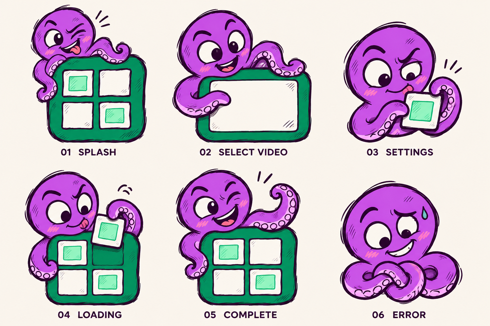

# Mascot design baseline — stage 2

The six-pose sheet establishes the production direction for the Mosaic mascot.
Reference identity: the approved rough cartoon octopus in `assets/icon/mosaic_octopus.png`.

## Identity rules

- Rounded purple octopus, expressive white eyes with deep purple pupils, asymmetric eyebrows.
- Pink cheek hatching, curled tentacles, pale lavender/pink suckers.
- Loose aubergine ink contours, irregular doubled strokes and sparse hand-drawn hatching.
- Flat cartoon shapes with restrained shading; avoid glossy 3D or perfectly smooth vector styling.
- Green props, white tiles and mint insets connect the character to the app's existing icon.
- The complete brand plaque keeps four white tiles in a 2 × 2 grid, with mint insets
  on the upper-left and lower-right tiles. Preserve this arrangement in final assets.
- Retain the approved icon silhouette for the splash pose, peeking from the upper left.

## Selected pose set

| ID | Purpose | Pose and expression | Planned placement |
|---|---|---|---|
| 01 | Splash | Upper-left peek behind the completed plaque; cheeky wink and small tongue-out grin. | Centered splash artwork above the app name. |
| 02 | Video selection / empty state | Hug an empty green video frame and gesture toward its center; curious welcoming expression. | Empty video queue and reusable empty Results state. |
| 03 | Settings | Compact half-body peeking pose, carefully straightening one tile; playful concentration. | Small header accent, separated from controls. |
| 04 | Loading | Steady a partially filled plaque and move a loose tile toward its remaining slot. | Near progress text, with real progress and cancellation separate. |
| 05 | Complete | Proudly present the completed plaque, wink, lift one curled tentacle. | Completion feedback, without covering generated previews. |
| 06 | Error | Look at gently tangled tentacles with an awkward smile and a tiny sweat drop. | Friendly error/retry guidance. |

## Loading motion specification for a later stage

Use a quiet repeating cycle: a tentacle lifts one tile, seats it in a vacant slot,
the character blinks, then the tile returns to its starting position. Suggested
cycle: 1.8–2.4 seconds. Keep the body anchored to avoid layout jumps. Do not imply
actual completion through the repeating tile cycle; use the real progress bar.
Provide a still fallback when animations are disabled or reduced motion is requested.

The review sheet illustrates one key pose per purpose, not animation frames.
Before animation authoring, separate body, eyes, mouth, moving tentacles, plaque,
and loose tile as appropriate for the chosen animation implementation. This sheet
is not a layered Rive file or a production sprite atlas.

## Stage 3 production requirements

Produce individual transparent assets from this baseline, with no labels or sheet
background. Match proportions and line weight across poses. Leave safe margins
for tentacle tips and sketch strokes. Keep poses readable at small display sizes;
reduce tiny hatching on the compact Settings asset. The sheet's prop positions
are illustrative: align the final loading tile with the canonical plaque pattern.

Use the same artwork in light and dark themes, checking dark outline visibility
against both surfaces. Keep screen text localized outside the artwork. Mascots
must not obscure video previews, settings controls, progress or cancel/retry actions.

This stage defines the artwork baseline. App screen integration and animation are
separate implementation stages; the launcher icon is already established.
