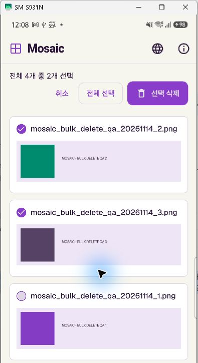
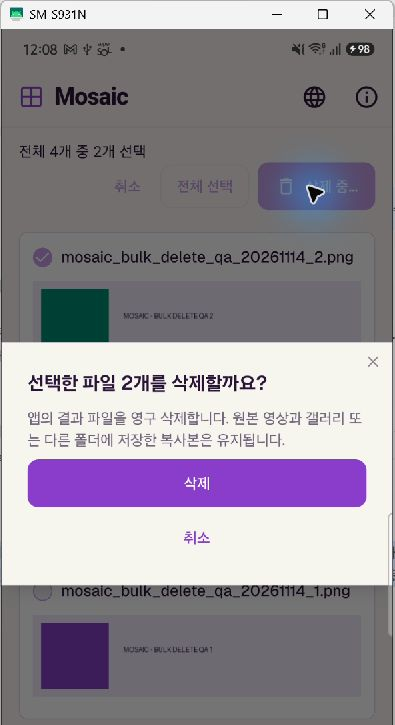

# Multiple-result deletion

Verified on November 14, 2026 using a physical Samsung SM-S931N (Android 16 / API 36) through scrcpy. The debug ARM64 APK was updated in place.

## Behavior

Results has a selection toolbar with per-file checkboxes, a selected/total count, Select all / Clear selection, Cancel, and Delete selected. The toolbar stays visible while the file list scrolls. Long-pressing an image starts selection; tapping images in selection mode toggles them instead of opening previews. Existing individual deletion remains available outside selection mode.

Deletion requires confirmation showing the number of selected files. Only app-private results are deleted; original videos and exported copies are retained. Successful deletions leave the list immediately. Missing files are removed from the list; other failures stay selected for retry. Generation, saving and deletion cannot modify a deletion batch concurrently. Korean, English and Japanese strings are included.

## Automated checks

- All 47 Flutter tests passed; code analysis reported no issues.
- New tests cover disabled deletion without a selection, Select all / Clear selection, cancellation preserving files and selection, deleting a subset while retaining unselected files, and existing single-file deletion through to the empty state.
- Folder export in progress disables selection until it completes.
- Original and exported-copy fixtures outside the result folder remain untouched.
- A filesystem failure retains the failed item and selection while successful and already-missing files leave the list.
- Selection controls and confirmation dialogs fit a 360-pixel-wide screen at 1.6× text scale in all three languages.

## Physical-device checks

Three clearly named synthetic PNG files were added for this test. Two were selected, the confirmation was cancelled, and all three files remained. The same two files were then deleted together through the confirmation dialog; the unselected fixture and pre-existing user result remained. The final fixture was removed through the individual delete control. The final result-file inventory matched the inventory recorded before adding fixtures. No pre-existing user results were deleted, exported or shared.

Screenshots are cropped below the synthetic fixtures to exclude personal result content.

| Two files selected | Confirmation with file count |
| --- | --- |
|  |  |
