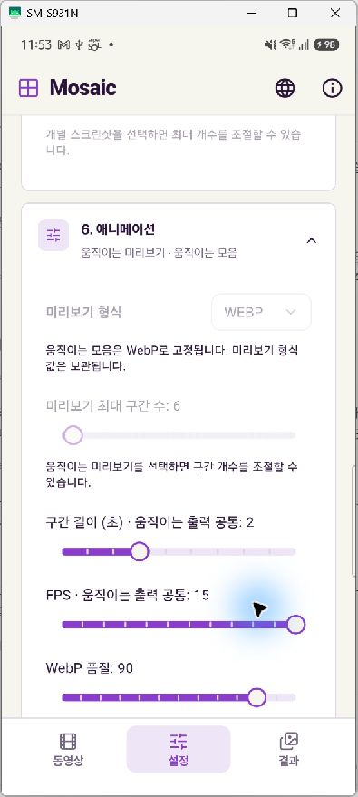
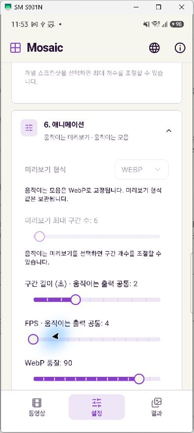
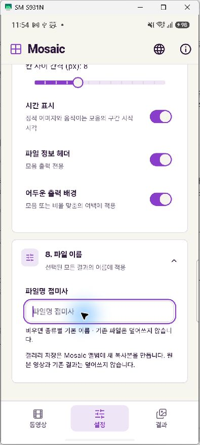

# Settings clipping verification

Verified on November 13, 2026 with a physical Samsung SM-S931N (Android 16 / API 36), operated through scrcpy. The updated debug APK was installed in place without removing existing settings or results.

## Changes

- Reserve horizontal space for slider thumbs, including their focus rings, at both track endpoints.
- Inset settings controls inside the accordion's animated clipping region so input and selection focus outlines remain visible.
- Stack the column/row controls when available width or enlarged text makes a horizontal pair too narrow.
- Vertically center result actions and keep space between wrapped action rows.

## Verification

- FPS at minimum (4) and maximum (15): complete round thumb visible at both ends. Restored FPS to its original value of 15.
- Disabled preview-count slider and active duration/WebP-quality sliders: no horizontal clipping observed.
- Focused filename suffix input: complete rounded outline visible, including while the keyboard is open. No suffix was entered.
- Existing result: long filename uses two lines; save, share, folder and delete controls remain inside the card. These actions were inspected without saving, sharing or deleting the result.
- `flutter analyze --no-pub`: no issues.
- `flutter test --no-pub`: all 41 tests passed, including narrow-width light/dark layouts with enlarged text and the new paint-bound regression test.
- Debug ARM64 APK build and installation: passed.

The regression test checks actual thumb rectangles and the input's outer focus-ring bounds against ancestor clipping rectangles; checking only for layout overflow would miss this paint clipping bug.

## Screenshots

Only settings screens are retained here.

| Maximum FPS | Minimum FPS | Focused filename input |
| --- | --- | --- |
|  |  |  |
