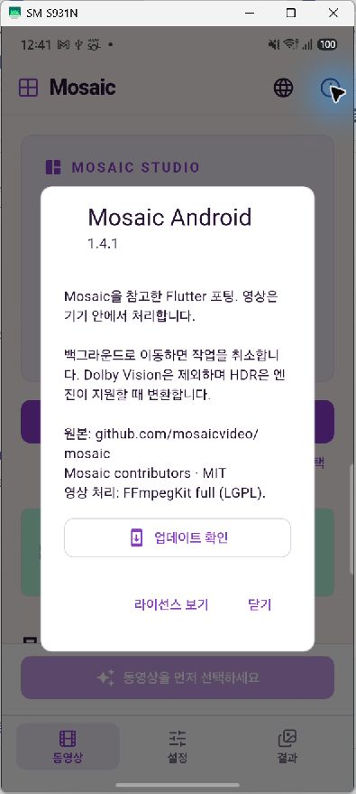
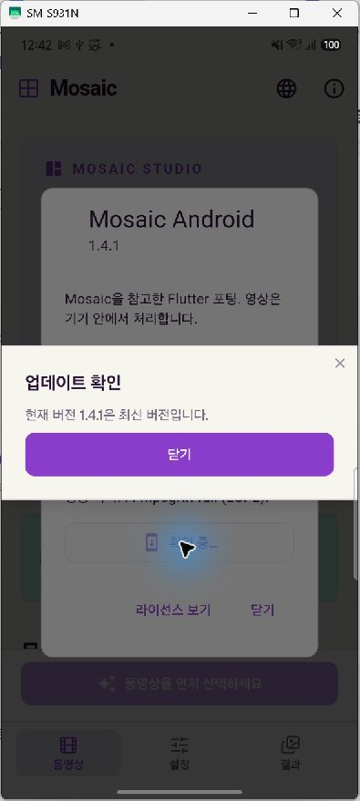

# GitHub APK updates

The Android release app checks the latest stable GitHub Release at most once per
24 hours when launched. Checks are silent when offline and deferred if processing,
saving or deletion is active before the update prompt is shown. App info also has
**Check for updates**, which bypasses the daily interval and reports failures.
Development builds have a different app ID/key and display an explanation instead
of offering a production APK as an in-place update.

The dialog shows installed/latest versions, release notes, download size, progress,
Cancel, retry after errors, and Install update after verification. Downloads go to
the app-private `cache/updates` directory. Interrupted/cancelled downloads are
removed; the completed APK is not exposed as a result or saved to the gallery.
Closing the dialog does not resume a partial download. A fresh attempt downloads
and verifies the whole file again.

Before installation, Android code checks the hash again and requires the APK's
package ID and current signer set to match the installed app, its version code to
match the release manifest, and that code to be higher than the installed code.
Only the dedicated update-cache directory is exposed by FileProvider. If Android
requires permission to install apps from Mosaic, its settings page opens. After
granting permission, return and press Install update again. Android presents the
final installation confirmation; the app never installs silently.

## Publishing a compatible release

1. Increase Flutter's version name/build number. Keep the production package ID
   and release signing key. Build and verify signed APKs.
2. Give each ABI APK a unique filename; ARM64-only releases update ARM64 devices.
3. Generate `mosaic-update.json` from the actual final APK files:

   ```sh
   python tool/prepare_github_update.py Mosaic-Android-v1.4.1-arm64.apk --aapt /path/to/Android/sdk/build-tools/36.1.0/aapt --out mosaic-update.json
   ```

4. Create a stable GitHub Release in `idlepoe/mosaic` with a matching version tag
   such as `v1.4.1`. Upload the APKs and `mosaic-update.json` before publishing.
   No GitHub token is embedded in the app. Public release downloads need no account.

The generated manifest records `schema: 1`, `packageName`, `version`, and an `apks`
array with `abi`, `asset`, `size`, `sha256`, and **actual Android `versionCode`**.
The latter includes Flutter's ABI split offset; it is not just the build number.
The updater verifies sizes against GitHub asset metadata, selects a supported ABI,
checks numeric versions, and verifies the downloaded SHA-256 before offering Install.
Initial asset URLs must belong to this repository's HTTPS release-download path;
redirects are restricted to HTTPS GitHub/CDN hosts. Draft/prerelease releases are
excluded. A newer release without valid metadata reports an error rather than
downloading an unverified file. Older releases without metadata remain readable.

Existing versions without this updater need one manual APK installation to gain
the feature. App-private results and settings survive a normal same-key update.

## Validation

Unit/widget tests cover numeric versions, installed build comparisons, ABI choice,
invalid metadata and URLs, streamed hashing and size checks, cancellation and
partial-file cleanup, verification failures and retry, native installation errors,
the permission-return flow, and Korean/English/Japanese dialogs at 1.6× text size.

On November 14, 2026, all 64 Flutter tests passed and analysis reported no issues.
The ARM64 release APK (1.4.1, Android version code 2010) passed `apksigner`
verification with the existing release certificate. On the physical SM-S931N,
the signed app launched and App info → Check for updates completed successfully.
Per the requested shortened test scope, a real older-to-newer installation and
permission-settings round trip were not performed on the device; those UI states
are covered by mocked widget tests. The existing `.dev` app and its files were
kept separate.

| App information | Manual check result |
| --- | --- |
|  |  |
